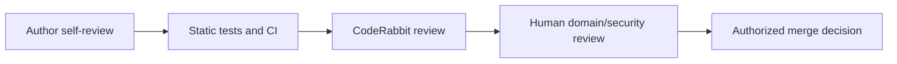

# AI Review Operating Model

**Outcome:** Explain what AI review can and cannot establish, and assign clear human accountability.

AI review can summarize change, surface suspicious patterns, propose improvements, answer questions, and apply repeatable instructions across many pull requests. It can miss defects, misunderstand domain intent, overstate risk, propose insecure code, or comment on irrelevant style. Its output is probabilistic evidence—not proof.

Use layered review:

Define review goals before configuration: reduce escaped defects, shorten feedback time, teach conventions, strengthen security, or summarize change. One profile cannot optimize everything. High-volume low-risk repositories may value concise feedback; regulated or security-sensitive paths need explicit instructions and mandatory human reviewers.

<strong>Check:</strong> CodeRabbit reports “no issues.” Is the change safe to merge? 

Feedback
Not on that fact alone. Confirm acceptance criteria, automated checks, human review, and the risk-specific controls required by policy.

