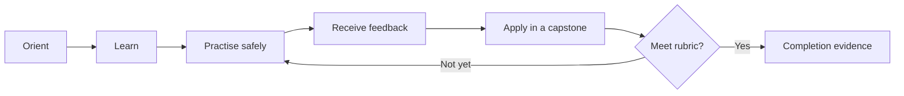

  
Skunkworks Academy · Self-paced collection

  <h1>Build, review, and sell with confidence.</h1>
  
Three independent, project-led courses that turn platform knowledge into observable workplace skill. Start anywhere, work at your pace, and leave with portfolio evidence.

  <article className="courseCard">
    
SKW-GH-101

    <h2>GitHub Foundations & Delivery</h2>
    
Manage repositories, collaborate through pull requests, automate delivery, and apply secure governance.

    
Beginner → intermediate12 hours3 labs

    <a className="buttonLink" href="./github/">Explore GitHub course →</a>
  </article>
  <article className="courseCard">
    
SKW-CR-201

    <h2>CodeRabbit AI Code Review</h2>
    
Configure trustworthy AI-assisted reviews, triage findings, prove fixes, and measure review quality.

    
Intermediate8 hours3 labs

    <a className="buttonLink" href="./coderabbit/">Explore CodeRabbit course →</a>
  </article>
  <article className="courseCard">
    
SKW-SH-101

    <h2>Shopify Store Operations</h2>
    
Plan, configure, merchandise, launch, operate, and improve a safe customer-ready Shopify store.

    
Beginner → intermediate14 hours3 labs

    <a className="buttonLink" href="./shopify/">Explore Shopify course →</a>
  </article>

## One consistent learning experience

Every course states prerequisites, measurable outcomes, workload, assessment rules, required evidence, accessibility options, and source currency. Each uses the same mastery loop:

Completion is a Skunkworks Academy course achievement, not an ISO-accredited personnel certification or a vendor certification.

## Choose your route

- New to collaborative delivery? Take **GitHub** first, then **CodeRabbit**.
- Launching or operating commerce? Take **Shopify**; GitHub is recommended if you will develop themes.
- Leading a team? Use the rubrics and capstones as role-based skills assessments.

