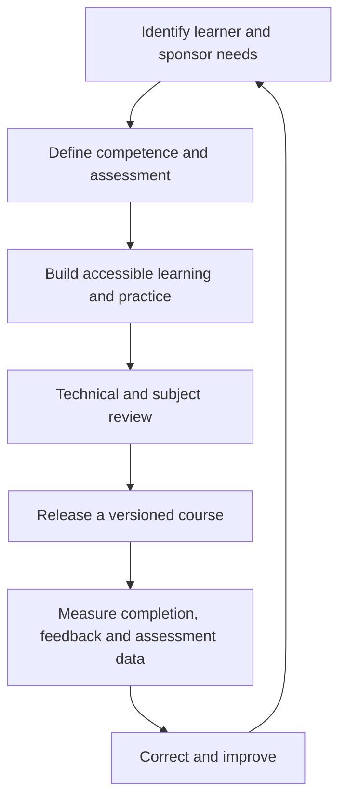

# Standards Alignment

**Status:** designed for alignment; not a claim of certification or accredited conformity.

The collection applies publicly described principles from current standards. Full conformity must be established against licensed standard texts, operating records, learner services, governance, and an independent audit where certification is sought.

| Quality need | Design evidence in this catalog | Reference |
|---|---|---|
| Learner-centred objectives and inclusive access | Course guides, measurable outcomes, accessibility alternatives, feedback and improvement route | ISO 21001:2025 |
| Transparent learning service | Audience, prerequisites, workload, delivery method, responsibilities, assessment and completion criteria | ISO 29993:2017 |
| E-learning quality assurance | Consistent process, source control, versioning, build validation, usability and evaluation checkpoints | ISO/IEC 40180:2017 |
| Valid competence decisions | Defined scheme scope, analytic rubrics, critical criteria, human oversight, moderation, retakes and appeals | ISO/IEC 17024:2026 principles |

## Quality lifecycle

## Release controls

- Named course owner and subject reviewer
- Version, release date, change log, and annual review date
- Broken-link, build, type, keyboard, contrast, and responsive checks
- Assessment blueprint mapping every outcome to evidence
- Pilot feedback from representative learners
- Recorded corrective actions and approval before release
- Vendor-source check after material product or policy changes

## References

- [ISO 21001:2025 — Educational organizations management systems](https://www.iso.org/standard/21001)
- [ISO 29993:2017 — Learning services outside formal education](https://www.iso.org/standard/70357.html)
- [ISO/IEC 40180:2017 — Quality for e-learning](https://www.iso.org/standard/62825.html)
- [ISO/IEC 17024:2026 — Certification of persons](https://www.iso.org/standard/17024)

